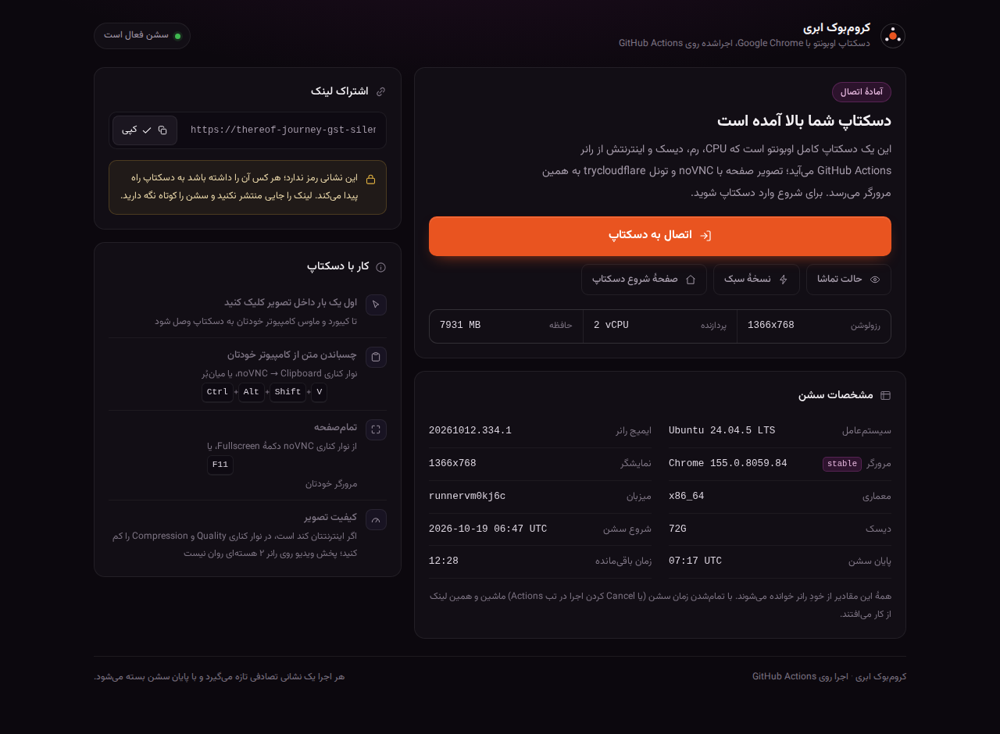
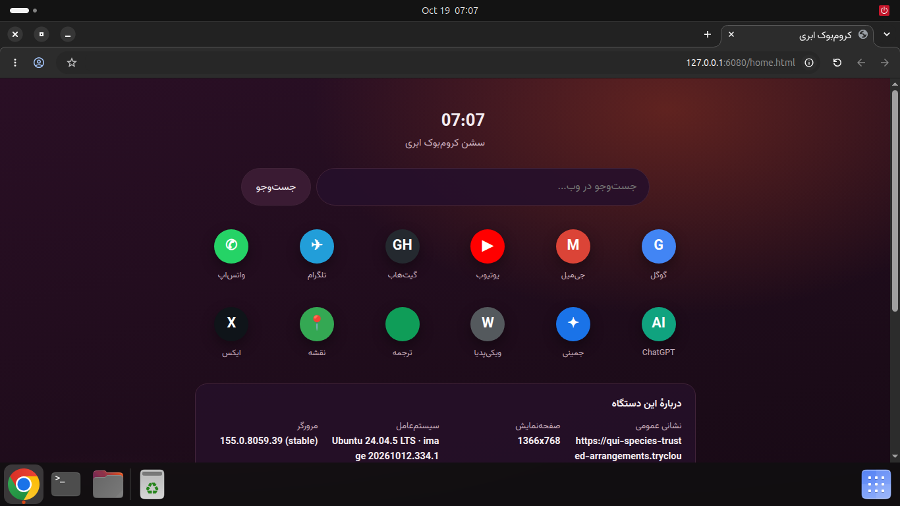

# Cloud "Chromebook" on GitHub Actions

یک **کروم‌بوک ابری**: دسکتاپ کامل لینوکس همراه با Google Chrome، کِروم‌بوک‌مانند (پنل پایین + آیکن برنامه‌ها)،
که با اجرای یک ورک‌فلو در **GitHub Actions** بالا می‌آید و تصویر زندهٔ آن با
`x11vnc + noVNC` از طریق تونل سریع **trycloudflare.com** به مرورگر خودتان می‌رسد.

CPU، رم، دیسک و پهنای‌باند همه از خودِ رانر GitHub Actions است؛ هیچ سرور یا نصب محلی لازم نیست.
(نسخهٔ وب پروژهٔ ترمینال [bug-free-giggle](https://github.com/Mimoli001/bug-free-giggle) — این نسخه snap-shot/ذخیره‌سازی ندارد
ولی دسکتاپش رمزدار است.)

> 🔐 **رمز اتصال:** برای دسکتاپ یک رمز بگذارید — با ورودی `password` در زمان اجرا یا (بهتر و امن‌تر)
> Secret مخزن `VNC_PASSWORD`. noVNC پیش از نشان‌دادن تصویر رمز را می‌پرسد و رمز **هیچ‌جا چاپ/نمایش داده نمی‌شود**
> (نه در لاگ، نه در خلاصهٔ اجرا، نه در صفحهٔ لندینگ). اگر مخزن **پابلیک** باشد و رمزی ست نشده باشد،
> اجرا عمداً با خطا متوقف می‌شود؛ چون در ریپوی پابلیک، لینک و لاگ‌ها برای همه قابل دیدن‌اند.

```
                    رانر GitHub Actions (ubuntu-24.04 + GNOME)                  مرورگر شما
┌───────────────────────────────────────────────────────────────┐   ┌────────────────────┐
│  Xvfb (:99) ─ GNOME Shell (Yaru + dock) ─ Google Chrome       │   │                    │
│        │                                                      │   │   https://<rand>.  │
│        ├── x11vnc      127.0.0.1:5900  (RFB, رمز دارد)        │   │   trycloudflare.   │
│        └── websockify  127.0.0.1:6080  (noVNC: HTTP + WS)     │   │   com              │
│                 │                                             │   └─────────▲──────────┘
│                 └── cloudflared quick tunnel ──────────────────────────────┘
└───────────────────────────────────────────────────────────────┘
```

## پیش‌نمایش

**صفحهٔ اتصال (لندینگ)** — همان صفحه‌ای که با باز کردن لینک `trycloudflare` می‌بینی (مقادیر این تصویر نمونه‌اند):



**دسکتاپ GNOME** (پیش‌فرض: `runner_image=ubuntu-24.04` + `desktop=auto`) — نوار بالای اوبونتو، داک پایین، Chrome تمام‌پنجره:



## راه‌اندازی (۳ مرحله)

1. این پوشه همین حالا در ریپوی **پابلیکِ** [Mimoli001/cloud-chromebook](https://github.com/Mimoli001/cloud-chromebook) است و آمادهٔ اجراست.
   (روی ریپوی پابلیک، دقیقه‌های Actions روی رانرهای استاندارد **رایگان و بی‌سقف** است؛ رمز دسکتاپ هم از Secret می‌آید
   و در مخزن دیده نمی‌شود.)
2. تب **Actions** → ورک‌فلوی **chromebook** → دکمهٔ **Run workflow**.
3. صبر کنید تا مرحلهٔ *Boot* تمام شود (~۲ تا ۴ دقیقه؛ بار اول بیشتر) و بعد یکی از این‌ها را باز کنید:

   * آدرس `https://<random>.trycloudflare.com` که در خلاصهٔ اجرا (Job Summary) و در لاگ با یک `::notice` نشان داده می‌شود،
   * اگر Secrets تلگرام را ست کرده باشید، همان لینک به تلگرام هم می‌آید.

   در صفحهٔ اول دکمهٔ **اتصال به دسکتاپ** را بزنید؛ اگر رمز ست کرده باشید noVNC اول رمز را می‌پرسد، بعد Chrome تمام‌پنجره
   باز می‌شود و دسکتاپ GNOME (نوار بالا + داک پایین) یا حالت سبک (شلف شناور پایین) را می‌بینی.

## داخل دسکتاپ چه خبر است؟

| | |
|---|---|
| **Google Chrome** | با فلگ‌های مناسب رانر (`--disable-gpu --test-type`؛ اگر سندباکس روی رانر کار نکند خودکار `--no-sandbox` می‌شود)، صفحهٔ اول یک «تب تازه»ٔ کِروم‌بوکی با آیکن سایت‌های پرکاربرد و جست‌وجوگر گوگل |
| **نسخهٔ Chrome و سیستم‌عامل** | کانال نصب (`chrome_channel`) و ایمیج رانر (`runner_image`) را خودت انتخاب می‌کنی؛ نسخهٔ واقعی در خلاصهٔ اجرا و در پنل «دربارهٔ این دستگاه» داخل دسکتاپ نوشته می‌شود |
| **دسکتاپ GNOME (پیش‌فرض)** | با `desktop=ubuntu` سشن **واقعی اوبونتو** بالا می‌آید: GNOME Shell + تم و آیکن **Yaru** + فونت **Ubuntu** + کرسر Yaru + داک پایین (Chrome، Terminal، Files) |
| **حالت سبک (classic)** | اگر GNOME نصب/اجرا نشود (یا `desktop=classic`) همان چیدمان سبک می‌آید: openbox + شلف شناور tint2 + کامپوزیتور picom |
| **ترمینال / فایل‌منیجر** | در حالت GNOME: `gnome-terminal` و `nautilus` (همان برنامه‌های اوبونتو)، در حالت سبک: `xterm` و `pcmanfm` |
| **فونت‌ها** | Ubuntu (لاتین) + Vazirmatn (فارسی) + Noto (فارسی/عربی درست رندر می‌شود) |
| **کلیپ‌بورد** | بین مرورگر شما و دسکتاپ همگام است (از نوار کناری noVNC یا `Ctrl+Alt+Shift+V`) |

## ورودی‌های ورک‌فلو

| ورودی | پیش‌فرض | توضیح |
|---|---|---|
| `runner_image` | `ubuntu-24.04` | ایمیج رانر: `ubuntu-24.04` (GNOME واقعی)، `ubuntu-26.04` (جدیدترین؛ ولی GNOME‏اش فقط Wayland است و روی Xvfb اجرا نمی‌شود)، `ubuntu-latest`، `ubuntu-22.04` |
| `chrome_channel` | `stable` | کانال Chrome: `stable` < `beta` < `unstable` (dev) < `canary` |
| `desktop` | `auto` | نوع دسکتاپ: `auto` = بهترین چیزی که همان ایمیج می‌تواند (GNOME واقعی اگر پشتیبانی شود، وگرنه حالت سبک) / `ubuntu` = زورکی GNOME / `classic` = حالت سبک کِروم‌بوکی |
| `shot` | `false` | اسکرین‌شات دسکتاپ **و** رندر صفحهٔ لانچر (base64) در لاگ اجرا نوشته شود — برای دیدن ظاهر بدون باز کردن لینک |
| `resolution` | `1600x900` | اندازهٔ صفحه. کوچک‌تر = روان‌تر (`1366x768`، `1280x720`) |
| `start_url` | خالی | صفحه‌ای که Chrome اول باز می‌کند (خالی = صفحهٔ شروع داخلی) |
| `ui_language` | `fa` | زبان رابط کاربری Chrome (`fa` = فارسی، `en-US` = انگلیسی) |
| `session_minutes` | `300` | مدت‌زمان سشن به دقیقه (حداکثر ۳۵۰، چون سقف هر Job در گیت‌هاب ۶ ساعت است) |
| `password` | خالی | رمز دسکتاپ (VNC/RFB). خالی بگذارید تا از Secret مخزن `VNC_PASSWORD` خوانده شود. فقط **۸ کاراکتر اول** در پروتکل VNC مؤثر است |
| `chain` | `false` | با تمام شدن زمان، خودکار یک اجرای تازه (لینک تازه) استارت شود |

## نسخه‌ها (سیستم‌عامل و Chrome)

* **Chrome**: مستقیم از `dl.google.com` به‌صورت `_current_amd64.deb` همان کانال نصب می‌شود، پس همیشه **آخرین بیلد آن کانال** است
  (چیزی که روی بقیهٔ سیستم‌ها هم می‌آید). نسخه‌ها در زمان نوشتن این README:

  | کانال | بسته | نسخه |
  |---|---|---|
  | `stable` (پیش‌فرض) | `google-chrome-stable` | 155.0.8059.84 |
  | `beta` | `google-chrome-beta` | 157.0.8103.6 |
  | `unstable` (Dev) | `google-chrome-unstable` | 158.0.8106.0 |
  | `canary` | `google-chrome-canary` | 158.0.8110.0 |

  نسخهٔ نصب‌شده هم در لاگ/خلاصهٔ اجرا چاپ می‌شود و هم داخل دسکتاپ در پنل «دربارهٔ این دستگاه» دیده می‌شود.
  اگر کانال `canary`/`unstable` را انتخاب کنی ممکن است گاهی صفحه‌ای خراب شود؛ برای کار روزمره `stable` یا `beta` بهتر است.

* **سیستم‌عامل**: پیش‌فرض `ubuntu-24.04` است (همان `ubuntu-latest` گیت‌هاب) چون **GNOME 46** آن سشن X11 دارد
  و روی Xvfb اجرا می‌شود. اگر «جدیدترین» را می‌خواهی `runner_image = ubuntu-26.04` را انتخاب کن — ولی آن ایمیج
  **GNOME 50** دارد که فقط Wayland است، پس دسکتاپ به‌صورت خودکار حالت سبک می‌شود (پایین را ببین).
  روی همان ایمیج `ImageVersion` را در خلاصهٔ اجرا می‌بینی.

## ظاهر دسکتاپ (اوبونتو واقعی)

* **`desktop=ubuntu`** (و پیش‌فرض `auto` روی ایمیج‌های ۲۴.۰۴/۲۲.۰۴): داخل رانر یک سشن **واقعی GNOME** بالا می‌آید —
  همان دسکتاپ اوبونتو — با تم و آیکن **Yaru**، فونت **Ubuntu**، کرسر Yaru، حالت تیره، داک پایین (Chrome/Terminal/Files)
  و والپیپر بنفش اوبونتو. چون رانر GPU ندارد GNOME با رندر نرم‌افزاری (llvmpipe) اجرا می‌شود؛ برای وب‌گردی و کار سبک خوب است.
* **مهم:** از **GNOME 49/50** (یعنی ایمیج‌های `ubuntu-25.10+`، از جمله `ubuntu-26.04`) سشن **X11 حذف شده** و
  فقط Wayland است؛ و چون این پروژه تصویر را با Xvfb می‌سازد، GNOME این ایمیج‌ها اجرا نمی‌شود.
  پس اگر GNOME واقعی می‌خواهی `runner_image=ubuntu-24.04` (یا `ubuntu-latest`/`22.04`) را انتخاب کن.
  حالت `auto` (پیش‌فرض) خودش همین را تشخیص می‌دهد: روی ۲۶.۰۴ حالت سبک، روی ۲۴.۰۴ GNOME واقعی.
* اگر GNOME نصب نشود یا بالا نیاید، اسکریپت **خودکار** به حالت سبک برمی‌گردد (openbox + شلف شناور + picom)
  و در خلاصهٔ اجرا/لاگ می‌نویسد کدام دسکتاپ فعال شده است. با `desktop=classic` هم می‌توانی از اول همان را بخواهی
  (سریع‌تر بوت می‌شود و سبک‌تر است).
* صفحهٔ لانچر (همان صفحهٔ اول) کامل بازطراحی شده: پنل تیرهٔ دوستونه با پالت اوبونتو، مشخصات کامل سشن،
  شمارش معکوس زندهٔ زمان باقی‌مانده (ساعت از سرور خوانده می‌شود)، دکمهٔ کپی لینک، راهنمای کار با دسکتاپ و
  وضعیت رمز اتصال («فعال (RFB)» / «غیرفعال») — بدون هیچ درخواست خارجی (فونت Vazirmatn داخل خود مخزن است، پس با اینترنت ایران هم درست می‌آید).
* صفحهٔ شروع Chrome و والپیپر هم با همان پالت اوبونتو (بنفش aubergine + نارنجی) هماهنگ شده‌اند.
* می‌خواهی ببینی چه شکلی است؟ یک اجرا با `shot: true` بزن؛ هم اسکرین‌شات دسکتاپ و هم رندر خودِ صفحهٔ لانچر
  (`PAGE-SHOT`) به‌صورت base64 در لاگ (مرحلهٔ *Screenshot*) می‌آید.

### تنظیمات اختیاری مخزن (Secrets / Variables)

| نوع | نام | کار |
|---|---|---|
| Secret | `VNC_PASSWORD` | **رمز دسکتاپ** — تا وقتی ست نشده باشد (و ورودی `password` هم خالی باشد) هر کس لینک را داشته باشد وارد می‌شود. روی مخزن پابلیک، بدون آن اجرا شکست می‌خورد |
| Secret | `TG_BOT_TOKEN`, `TG_CHAT_ID` | لینک آماده‌شدن سشن (و لینک جدید بعد از ری‌استارت تونل) به تلگرام می‌آید |
| Secret | `CF_TUNNEL_TOKEN` | اگر تونل نام‌دار خودتان را دارید، به‌جای trycloudflare از آن استفاده می‌شود |
| Variable | `CF_HOSTNAME` | دامنهٔ ثابت آن تونل نام‌دار (مثلاً `cloud.example.com`) |

### رمز و امنیت (چه چیزی محافظت می‌شود؟)

* **محافظت‌شده:** خودِ دسکتاپ. `x11vnc` با `-rfbauth` بالا می‌آید (فایل رمز با مجوز `600` در `/tmp/chromebook/vncpasswd`)
  و noVNC تا رمز درست را نگیرد تصویری نشان نمی‌دهد. `boot` بعد از بالا آمدن سرور، خودش از خودِ x11vnc می‌پرسد
  که چه روش‌های احراز هویتی پیشنهاد می‌دهد؛ اگر ببیند بدون رمز هم راه می‌دهد، **اجرا را عمداً با خطا متوقف می‌کند**
  (fail-closed) تا هیچ‌وقت دسکتاپ بی‌رمز بالا نیاید.
* **محافظت‌نشده:** صفحهٔ لندینگ و خودِ لینک `trycloudflare`. هر کس لینک را داشته باشد می‌تواند صفحه را ببیند
  (ولی بدون رمز فقط صفحهٔ راهنما را می‌بیند، نه دسکتاپ). رمز **هرگز** در آن صفحه یا در لاگ چاپ نمی‌شود.
* رمز در `x11vnc -storepasswd` می‌رود و فقط وضعیتش گزارش می‌شود؛ ورک‌فلو هم اول کار `::add-mask::` می‌زند تا اگر رمز
  را از ورودی اجرا داده باشید در لاگ‌ها ماسک شود. برای همین در `status` فقط این را می‌بینید:
  `auth=on (RFB password required)` — که واقعاً از خود سرور پرسیده می‌شود، نه از تنظیمات.
  این مسیر با یک کلاینت واقعی VNC تست شده است: رمز درست وصل می‌شود، رمز غلط با `password check failed` رد می‌شود.
* **زنجیره‌سازی (`chain: true`) رمز را از Secret می‌خواند، نه از ورودی‌ها**؛ پس اگر می‌خواهی سشن‌ها پشت‌سرهم و بامنطق باشند، رمز را در Secret بگذار.
* پروتکل VNC فقط **۸ کاراکتر اول** رمز را منتقل می‌کند؛ رمز بلندتر بی‌فایده است (مثلاً `Pass1234` دقیقاً ۸ کاراکتر است).
  رمز واقعی را فقط در Secret بگذارید، نه در README یا ورودی‌های اجرا.
* مخزن **پابلیک** مزیت هم دارد: دقیقه‌های Actions روی رانرهای استاندارد برای ریپوهای پابلیک **رایگان و بی‌سقف** است
  (بر خلاف ریپوی خصوصی که از سهمیهٔ ماهانه مصرف می‌کند).

## محدودیت‌ها (بخوانید!)

* **سقف ۶ ساعت** برای هر Job. با `chain: true` می‌شود زنجیرهٔ پشت‌سرهم ساخت، ولی هر اجرا **لینک و دسکتاپ تازه** دارد
  (چون بخش ذخیره‌سازی/اسنپ‌شات در این نسخه نیست؛ هرچه نصب یا ذخیره کنید با پایان سشن می‌رود).
* منابع رانر: ۲ هستهٔ CPU، ۷ گیگ رم، ~۱۴ گیگ دیسک. کارهای سبک (وب‌گردی، چت، کدنویسی، ایمیل) خوب است؛
  ویدیوی سنگین و بازی نه (GPU ندارد، رندر نرم‌افزاری است).
* تونل quick محبوب است ولی تضمین SLA ندارد؛ اگر لینک باز نشد یک‌بار دیگر Run workflow بزنید.
* تأخیر تصویر معمولاً ۸۰–۳۰۰ms است؛ `quality`/`compression` در `chromebook.sh` (`NOVNC_QUALITY`, `NOVNC_COMPRESSION`) قابل تنظیم است.
* لینک quick tunnel محبوب است ولی هر کس لینک را داشته باشد **صفحهٔ لندینگ** را می‌بیند؛ **دسکتاپ** پشت رمز است
  (`VNC_PASSWORD` یا ورودی `password`). سشن‌های کوتاه، Cancel کردن بعد از کار، و لینک نگذاشتن جای عمومی همچنان توصیه می‌شود.
  برای کار جدی‌تر می‌توانید `CF_TUNNEL_TOKEN` + Cloudflare Access را هم روی همین تونل بگذارید.

## عیب‌یابی

| نشانه | کار |
|---|---|
| لینک در لاگ نیست | مرحلهٔ *Boot* را ببینید و `$LOGS/cloudflared.log` را وقتی سشن بالاست با ترمینال خودِ دسکتاپ بخوانید |
| «اتصال به دسکتاپ» صفحهٔ سیاه می‌دهد | چند ثانیه صبر کنید (noVNC هر ۲ ثانیه retry می‌کند) یا `vnc_lite.html` را امتحان کنید |
| رمز را می‌پرسد و قبول نمی‌کند | فقط ۸ کاراکتر اول رمز مهم است؛ در `status` باید `auth=on (RFB password required)` ببینید. اگر رمز یادت رفته، اجرا را Cancel کن و با `password` تازه اجرا بگیر |
| تصویر یخ می‌زند | در نوار کناری noVNC → `Disconnect` و دوباره وصل شوید؛ watchdog در ورک‌فلو سرویس‌های مرده را ری‌استارت می‌کند |
| Chrome بالا نمی‌آید | در ترمینال: `pgrep -a chrome`، `cat /tmp/chromebook/logs/chrome.log` |
| می‌خواهم چند ساعت بیشتر | `session_minutes` و `chain: true` |

لاگ همهٔ سرویس‌ها در `/tmp/chromebook/logs/` رانر است (`xvfb`, `openbox`, `tint2`, `x11vnc`, `websockify`, `cloudflared`, `chrome`).

## ساختار فایل‌ها

```
.github/workflows/chromebook.yml        ورک‌فلو: نصب، بوت، سشن watchdog، زنجیره‌سازی
.github/chromebook/chromebook.sh        اسکریپت اصلی: install | boot | hold | url | status
.github/chromebook/assets/wallpaper.py  ساخت والپیپر (فقط کتابخانهٔ استاندارد پایتون)
.github/chromebook/assets/tint2rc       شلف پایین (آیکن‌ها/تسک‌بار/ساعت)
.github/chromebook/assets/openbox/rc.xml تنظیم پنجره‌ها (Chrome بدون حاشیه و تمام‌صفحه)
.github/chromebook/assets/web/index.html صفحهٔ اول لینک عمومی (لانچر اتصال)
.github/chromebook/assets/web/home.html  صفحهٔ شروع Chrome داخل دسکتاپ
.github/chromebook/assets/web/fonts/     فونت Vazirmatn (woff2، بدون CDN)
.github/chromebook/assets/picom.conf   کامپوزیتور حالت سبک (سایه/گوشه‌ها)
docs/preview-*.png                       پیش‌نمایش صفحهٔ اتصال و دسکتاپ
```

## اجرای دستیِ اسکریپت روی هر لینوکس (برای تست)

```bash
export RESOLUTION=1366x768 SESSION_SECONDS=3600
bash .github/chromebook/chromebook.sh install
bash .github/chromebook/chromebook.sh boot
bash .github/chromebook/chromebook.sh status   # در ترمینال دیگر
bash .github/chromebook/chromebook.sh hold     # تا زمان‌سقف بیدار نگه می‌دارد
```
